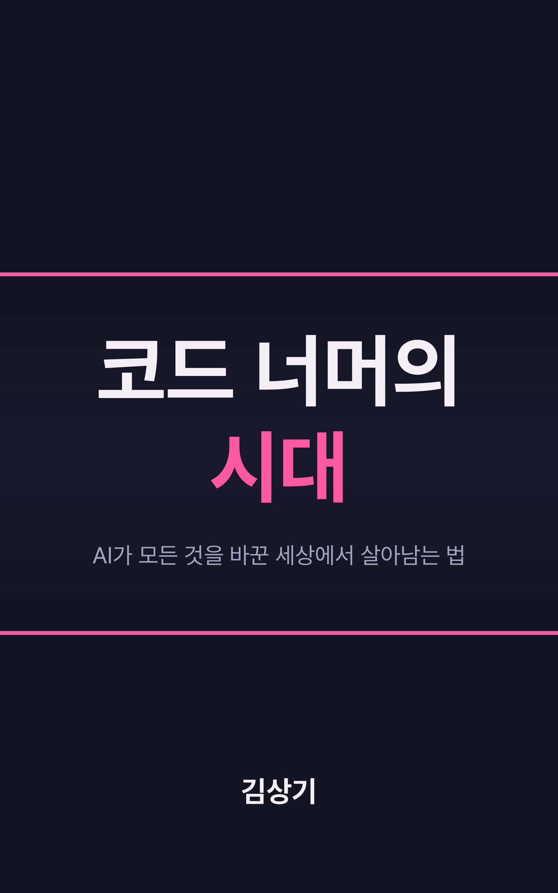

# 코드 너머의 시대

> AI가 모든 것을 바꾼 세상에서 살아남는 법

"코드 너머, 회사보다 오래 남을 개발자" (한빛미디어, 2025)의 후속작입니다. AI가 코드를 쓰는 시대, 개발자와 비개발자 모두에게 필요한 역량과 마인드셋을 이야기합니다.

## 읽기

- **웹 버전**: [GitHub Pages에서 읽기](https://ksangki.github.io/beyond-code-era/)
- **발표 자료**: [1시간 발표용 슬라이드](https://ksangki.github.io/beyond-code-era/presentation/) · 웹 버전 첫 화면에서도 연결된다
- **오프닝 영상**: [60초 모션그래픽](https://ksangki.github.io/beyond-code-era/media/opening.mp4) · 웹 버전 첫 화면에도 실려 있다
- **EPUB**: [`코드-너머의-시대-v1.0.4.epub`](코드-너머의-시대-v1.0.4.epub) 다운로드

## 판 이력

- v1.0.4 (2026-11-07): 문체 2차 점검(한국어 표현 지침), 178곳 정리, 내용·수치 변경 없음
- v1.0.3 (2026-11-02): 2·4·5·7·9장 인용 출처의 기업 이름을 업종 표기(국내 IT 서비스 기업)로 바꿈, 제목·부제·저자를 넣은 새 표지. 인용문과 다른 내용은 그대로
- v1.0.2 (2026-11-01): 2장 인용문 오타 수정(다린다→다룬다)
- v1.0.1 (2026-11-01): 문체 점검: AI 문체 패턴 415곳 정리, 내용·수치 변경 없음
- v1.0.0 (2026-05-02): 초판

## 목차

| PART | 장 | 제목 |
|------|---|------|
| **PART 1** | 1장 | AI가 코드를 쓰는 시대 |
| 지금 무슨 일이 벌어지고 있는가 | 2장 | 당신의 자리는 안전한가 |
| **PART 2** | 3장 | AI가 가져간 것들 |
| 무엇이 남고, 무엇이 사라지는가 | 4장 | AI가 가져갈 수 없는 것들 |
| | 5장 | 모두가 개발자가 되는 세상 |
| **PART 3** | 6장 | 무엇을 만들 것인가 |
| 다음 시대의 경쟁력 | 7장 | AI와 함께 일하는 법 |
| | 8장 | 오래 가는 사람의 학습법 |
| **PART 4** | 9장 | 코드 너머에서 만나는 것들 |
| 코드 너머의 세계로 | | |

## 핵심 메시지

> "AI가 당신을 대체하지 않습니다. AI를 사용하는 사람이 대체합니다."

> "회사보다 오래 남을 개발자"에서 "시대보다 오래 남을 사람"으로.

## 저자

김상기

## 라이선스

책 본문은 [CC BY-NC-SA 4.0](https://creativecommons.org/licenses/by-nc-sa/4.0/deed.ko)(저작자 표시·비영리·동일조건 변경허락)으로 배포한다. EPUB 판권 면과 같은 표기다.
